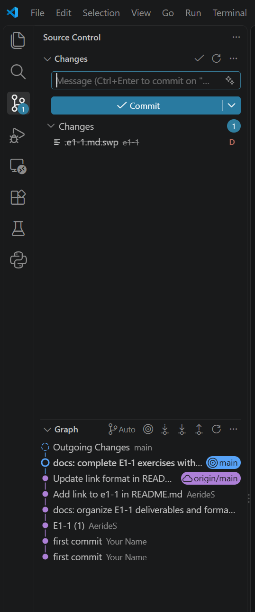
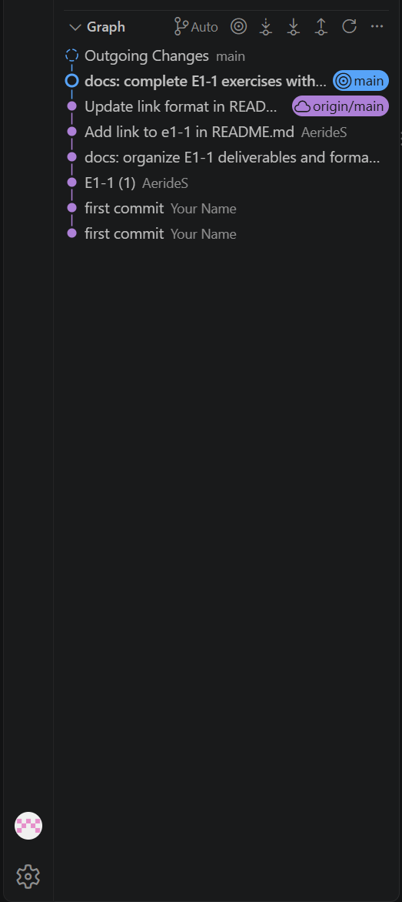

# E1-1. 내 컴퓨터에 개발자용 '작업실' 꾸미기

> 실습일: 2026-11-02 (KST). 전체 실행 기록은 `logs/`에 정리했다. `[exit=N]`은 명령 종료 코드이며 이메일은 마스킹했다.

## 1. 제출 저장소(GitHub Repository)

- 공개 저장소: [AerideS/Codyssey](https://github.com/AerideS/Codyssey)
- 문서: [README.md](../README.md) → [e1-1.md](./e1-1.md)
- 웹 서버 소스: [app/index.html](./app/index.html)
- 이미지 정의: [Dockerfile](./Dockerfile), 빌드 컨텍스트 설정: [.dockerignore](./.dockerignore)
- 실습 재실행 도구: [scripts/verify.py](./scripts/verify.py)
- 브라우저 캡처 도구: [scripts/capture_browser.py](./scripts/capture_browser.py)
- 공개 여부 확인: [GitHub 연동 로그](./logs/10-git-github.log)의 `private: false`.

## 2. 기술 문서

### 2.1. 프로젝트 개요

터미널 기본 명령과 권한 변경을 실습했다. NGINX 기반 Docker 이미지를 만들고 포트 매핑으로 웹 서버에 접속했다. 바인드 마운트의 파일 변경 반영과 볼륨의 데이터 유지를 확인하고, GitHub와 VSCode에서 저장소를 연결했다.

### 2.2. 실행 환경

| 항목 | 실제 확인 결과 |
| --- | --- |
| OS | Ubuntu 22.04.5 LTS (Jammy Jellyfish), Linux x86_64 |
| Shell | Bash (`/bin/bash`) |
| 터미널 | VSCode Remote / Bash (`TERM=dumb`) |
| Docker Client / Server | 29.9.1 / 29.9.1 |
| Git | 2.34.1 |
| 캡처용 브라우저 | Mozilla Firefox 158.0 |

실행 기록: [OS·Shell·Git](./logs/03-environment.log), [Docker](./logs/04-docker-info.log), [Firefox](./logs/11-browser-capture.log).

```console
$ cat /etc/os-release
PRETTY_NAME="Ubuntu 22.04.5 LTS"
NAME="Ubuntu"
VERSION_ID="22.04"
VERSION="22.04.5 LTS (Jammy Jellyfish)"
VERSION_CODENAME=jammy
ID=ubuntu
ID_LIKE=debian
HOME_URL="https://www.ubuntu.com/"
SUPPORT_URL="https://help.ubuntu.com/"
BUG_REPORT_URL="https://bugs.launchpad.net/ubuntu/"
PRIVACY_POLICY_URL="https://www.ubuntu.com/legal/terms-and-policies/privacy-policy"
UBUNTU_CODENAME=jammy
[exit=0]
```

```console
$ bash -c 'printf "Shell=%s\nTERM=%s\n" "$SHELL" "$TERM"'
Shell=/bin/bash
TERM=dumb
[exit=0]
```

```console
$ docker --version
Docker version 29.9.1, build dfc520d
[exit=0]
```

```console
$ git --version
git version 2.34.1
[exit=0]
```

### 2.3. 수행 항목 체크리스트

- [x] 터미널 기본 조작: 위치·숨김 파일 목록·이동·생성·복사·이름 변경·삭제·내용 확인·빈 파일 생성.
- [x] 파일 1개·디렉토리 1개의 권한 변경 전/후 비교.
- [x] Docker 버전 확인.
- [x] Docker 데몬 점검: `docker info`의 Server 응답 확인.
- [x] `hello-world` 실행 성공.
- [x] Ubuntu 컨테이너 실행 및 대화형 내부 명령 수행.
- [x] `exec`/`attach`, `exit`/분리 키에 따른 종료·유지 관찰.
- [x] Docker 이미지 다운로드·목록, 컨테이너 실행·중지·목록, 로그·리소스 확인.
- [x] Dockerfile 기반 커스텀 이미지 빌드 및 실행.
- [x] `18080:80`, `18081:80` 두 포트 매핑과 웹 응답 확인.
- [x] 주소창과 응답이 함께 보이는 브라우저 화면 첨부.
- [x] 바인드 마운트의 호스트 변경 전/후 웹 응답 비교.
- [x] Docker 볼륨의 컨테이너 삭제 전/후 파일 내용·해시 비교.
- [x] Git 사용자 정보 및 기본 브랜치 설정 확인.
- [x] GitHub 공개 저장소 연결, 기존 커밋·푸시 결과 및 원격 커밋 확인.
- [x] VSCode 저장소 연동 및 소스 제어·커밋 그래프 화면 첨부.
- [x] 트러블슈팅 2건: 샌드박스 Docker 접근 오류, 파일 읽기 권한 오류 재현·복구.

### 2.4. 검증 방법 및 결과 위치

| 검증 항목 | 사용한 명령 / 확인 방법 | 전체 증거 |
| --- | --- | --- |
| 터미널 기본 조작 | `pwd`, `ls -la`, `cd`, `mkdir`, `touch`, `cat`, `cp`, `mv`, `rm`, `rmdir` | [01-terminal.log](./logs/01-terminal.log) |
| 권한 전/후 비교 | `chmod`, `stat`, `cat` | [02-permissions.log](./logs/02-permissions.log) |
| 실행 환경 | OS·Shell·Docker·Git 조회 | [03-environment.log](./logs/03-environment.log) |
| Docker 설치·데몬 | `docker --version`, `docker info` | [04-docker-info.log](./logs/04-docker-info.log) |
| hello-world | `docker pull`, `docker run --rm` | [05-hello-world.log](./logs/05-hello-world.log) |
| Ubuntu 종료·유지 | `docker exec -it`, `docker attach`, `docker inspect`, `docker stop`, `docker ps -a` | [06-ubuntu-lifecycle.log](./logs/06-ubuntu-lifecycle.log) |
| 빌드·운영·접속 | `docker build`, `images`, `run`, `ps`, `port`, `logs`, `stats`, `curl` | [07-web-build-run.log](./logs/07-web-build-run.log) |
| 바인드 마운트 | 호스트 파일 수정 후 `curl` 응답 재확인 | [08-bind-mount.log](./logs/08-bind-mount.log) |
| 볼륨 영속성 | `docker volume create`, 컨테이너 삭제·재생성, `cat`, `sha256sum` | [09-volume-persistence.log](./logs/09-volume-persistence.log) |
| Git·GitHub | `git config`, `remote`, `log`, `ls-remote`, 공개 저장소 API | [10-git-github.log](./logs/10-git-github.log) |
| VSCode | 소스 제어와 커밋 그래프 확인 | [소스 제어](./screenshots/vscode-source-control.png), [커밋 그래프](./screenshots/vscode-github.png) |
| 브라우저 | Firefox 실행, 실제 창 확인, 전체 화면 캡처 | [11-browser-capture.log](./logs/11-browser-capture.log), [접속 화면](./screenshots/web-18080.png) |
| Docker 접근 문제 | 제한된 세션과 호스트 세션 비교 | [오류](./logs/12-sandbox-docker-access.log), [해결 확인](./logs/13-host-docker-access.log) |
| 최종 재확인 | 두 포트의 HTTP 200, 웹·Ubuntu 상태, 보존된 볼륨의 파일·해시 확인 | [14-final-validation.log](./logs/14-final-validation.log) |

### 2.5. 트러블슈팅

#### 사례 1. Docker 버전은 조회되지만 데몬 접근이 거부됨

- **문제:** 제한된 실행 세션에서 `docker info`의 Client 정보는 출력되지만 Server에서 `permission denied`가 발생했다.
- **원인 가설:** 실행 세션에 Docker 소켓 접근 권한이 없다.
- **확인:** 제한된 세션의 `id`에는 `docker` 그룹이 없었다. 호스트에서 실행한 `id`에는 `999(docker)`가 있었다.
- **해결/대안:** `docker` 그룹 권한이 있는 호스트 세션에서 명령을 실행했다.
- **결과:** `ServerVersion=29.9.1 OSType=linux` 응답을 확인했다.

오류 전체: [12-sandbox-docker-access.log](./logs/12-sandbox-docker-access.log). 해결 전체: [13-host-docker-access.log](./logs/13-host-docker-access.log).

```console
$ id
uid=1000(oem) gid=1000(oem) groups=1000(oem),4(adm),24(cdrom),27(sudo),30(dip),46(plugdev),110(lxd),999(docker)
[exit=0]

$ docker info --format 'ServerVersion={{.ServerVersion}} OSType={{.OSType}}'
ServerVersion=29.9.1 OSType=linux
[exit=0]
```

#### 사례 2. 읽기 권한이 없는 파일에서 Permission denied 발생

`chmod 000`으로 읽기 권한을 없애 오류를 재현했다.

- **문제:** `sample.txt`를 `000`으로 바꾼 뒤 `cat`이 종료 코드 1로 실패했다.
- **원인 가설:** 파일 소유자에게 읽기 권한이 없다.
- **확인:** `stat`에서 `0 ---------- sample.txt`를 확인했다.
- **해결/대안:** `chmod 644 sample.txt`로 필요한 읽기 권한을 복구했다.
- **결과:** `cat`이 `permission practice`를 출력하고 종료 코드 0으로 성공했다.

명령·오류·복구 결과는 [3.2. 권한 실습](#32-파일디렉토리-권한-실습) 및 [전체 로그](./logs/02-permissions.log)에 기록했다.

## 3. 터미널 조작 로그

### 3.1. 디렉토리와 파일 기본 조작

`e1-1/`에서 시작해 `practice/terminal/`에 실습 파일을 만들었다. 명령별 작업 위치는 다음과 같다.

1. `pwd`부터 `mkdir -p practice/terminal practice/permissions`까지: `e1-1/`에서 수행.
2. `cd practice/terminal && pwd`: 상대 경로 이동 후 위치 확인.
3. 이후 `touch`부터 마지막 `ls -la`까지: `e1-1/practice/terminal/`에서 수행.

```console
$ pwd
/home/oem/Desktop/lgh/Codyssey/e1-1
[exit=0]

$ ls -la
total 52
drwxrwxr-x 6 oem oem  4096 Nov  2 15:16 .
drwxrwxr-x 7 oem oem  4096 Nov  2 15:16 ..
-rw-rw-r-- 1 oem oem    28 Nov  2 15:16 .dockerignore
-rw-rw-r-- 1 oem oem  1024 Nov  2 13:08 .e1-1.md.swp
-rw-rw-r-- 1 oem oem   188 Nov  2 12:56 Dockerfile
drwxrwxr-x 3 oem oem  4096 Nov  2 13:02 app
-rw-rw-r-- 1 oem oem 15615 Nov  2 14:55 e1-1.md
drwxrwxr-x 2 oem oem  4096 Nov  2 15:16 logs
drwxrwxr-x 2 oem oem  4096 Nov  2 12:51 screenshots
drwxrwxr-x 2 oem oem  4096 Nov  2 15:16 scripts
[exit=0]

$ mkdir -p practice/terminal practice/permissions
[exit=0]

$ bash -c 'cd practice/terminal && pwd'
/home/oem/Desktop/lgh/Codyssey/e1-1/practice/terminal
[exit=0]

$ touch empty.txt .hidden
[exit=0]

$ bash -c 'printf '"'"'Hello Codyssey CLI\n'"'"' > original.txt'
[exit=0]

$ ls -la
total 12
drwxr-xr-x 2 oem oem 4096 Nov  2 15:16 .
drwxr-xr-x 4 oem oem 4096 Nov  2 15:16 ..
-rw-r--r-- 1 oem oem    0 Nov  2 15:16 .hidden
-rw-r--r-- 1 oem oem    0 Nov  2 15:16 empty.txt
-rw-r--r-- 1 oem oem   19 Nov  2 15:16 original.txt
[exit=0]

$ cat original.txt
Hello Codyssey CLI
[exit=0]

$ cp original.txt copy.txt
[exit=0]

$ mv copy.txt renamed.txt
[exit=0]

$ mkdir -p archive
[exit=0]

$ mv renamed.txt archive/renamed.txt
[exit=0]

$ cat archive/renamed.txt
Hello Codyssey CLI
[exit=0]

$ rm archive/renamed.txt
[exit=0]

$ rmdir archive
[exit=0]

$ ls -la
total 12
drwxr-xr-x 2 oem oem 4096 Nov  2 15:16 .
drwxr-xr-x 4 oem oem 4096 Nov  2 15:16 ..
-rw-r--r-- 1 oem oem    0 Nov  2 15:16 .hidden
-rw-r--r-- 1 oem oem    0 Nov  2 15:16 empty.txt
-rw-r--r-- 1 oem oem   19 Nov  2 15:16 original.txt
[exit=0]
```

절대 경로는 `/home/oem/Desktop/lgh/Codyssey/e1-1`처럼 `/`부터 시작한다. 상대 경로는 현재 위치가 기준이다. `e1-1/`에서 `cd practice/terminal`을 실행하면 `e1-1/practice/terminal/`로 이동한다.

### 3.2. 파일·디렉토리 권한 실습

`practice/permissions/`에서 파일 권한을 `600 → 644`, 디렉토리 권한을 `700 → 755`로 바꾸고 `stat`으로 비교했다.

```console
$ bash -c 'printf '"'"'permission practice\n'"'"' > sample.txt'
[exit=0]

$ mkdir -p sample-dir
[exit=0]

$ chmod 600 sample.txt
[exit=0]

$ chmod 700 sample-dir
[exit=0]

$ stat -c '%a %A %n' sample.txt sample-dir
600 -rw------- sample.txt
700 drwx------ sample-dir
[exit=0]

$ chmod 644 sample.txt
[exit=0]

$ chmod 755 sample-dir
[exit=0]

$ stat -c '%a %A %n' sample.txt sample-dir
644 -rw-r--r-- sample.txt
755 drwxr-xr-x sample-dir
[exit=0]

$ chmod 000 sample.txt
[exit=0]

$ cat sample.txt
cat: sample.txt: Permission denied
[exit=1]

$ stat -c '%a %A %n' sample.txt
0 ---------- sample.txt
[exit=0]

$ chmod 644 sample.txt
[exit=0]

$ cat sample.txt
permission practice
[exit=0]
```

권한은 소유자·그룹·기타 사용자 순서로 읽는다. 각 숫자는 `r=4`, `w=2`, `x=1`을 더한 값이다.

| 권한 | 소유자 | 그룹 | 기타 사용자 | 의미 |
| --- | --- | --- | --- | --- |
| 파일 `644` | `rw-` | `r--` | `r--` | 소유자는 읽기·쓰기, 나머지는 읽기 |
| 디렉토리 `755` | `rwx` | `r-x` | `r-x` | 소유자는 목록·항목 변경·진입, 나머지는 목록·진입 |

파일의 `x`는 실행 권한이다. 디렉토리의 `x`는 경로를 통과해 진입하거나 내부 항목에 접근하는 권한이며, `r`은 항목 목록을 읽는 권한이다.

## 4. Docker 운영/검증 로그

### 4.1. 설치 및 데몬 점검

`docker --version`과 `docker info`로 Client·Server 버전을 확인했다. [전체 로그](./logs/04-docker-info.log)

```console
$ docker --version
Docker version 29.9.1, build dfc520d
[exit=0]
```

Docker 데몬 응답:

```console
$ docker info --format 'ServerVersion={{.ServerVersion}} OSType={{.OSType}}'
ServerVersion=29.9.1 OSType=linux
[exit=0]
```

### 4.2. hello-world 실행

`hello-world:latest`를 내려받아 실행했고 `Hello from Docker!`를 확인했다. [전체 로그](./logs/05-hello-world.log)

```console
$ docker run --rm hello-world:latest

Hello from Docker!
This message shows that your installation appears to be working correctly.

To generate this message, Docker took the following steps:
 1. The Docker client contacted the Docker daemon.
 2. The Docker daemon pulled the "hello-world" image from the Docker Hub.
    (amd64)
 3. The Docker daemon created a new container from that image which runs the
    executable that produces the output you are currently reading.
 4. The Docker daemon streamed that output to the Docker client, which sent it
    to your terminal.

... (이하 전체 로그 참조)
```

### 4.3. Ubuntu 컨테이너 내부 진입 및 종료·유지 관찰

`bash`를 주 프로세스로 실행했다. `exec`로 연 셸에서 나왔을 때와 `attach`로 연결한 셸에서 나왔을 때의 컨테이너 상태를 비교했다.

```console
$ docker run -dit --name codyssey-e1-1-check-ubuntu ubuntu:22.04 bash
8cf7096835dff6adda7330b7f456400b57d12b48dc60ddb4578f5f29d2954dc3
[exit=0]

$ docker exec -it codyssey-e1-1-check-ubuntu bash
root@8cf7096835df:/# echo 'Hello Codyssey exec'
Hello Codyssey exec
root@8cf7096835df:/# pwd
/
root@8cf7096835df:/# ls /
bin   dev  home  lib32  libx32  mnt  proc  run   srv  tmp  var
boot  etc  lib   lib64  media   opt  root  sbin  sys  usr
root@8cf7096835df:/# exit
exit

[exit=0]

$ docker inspect --format '{{.State.Status}}' codyssey-e1-1-check-ubuntu
running
[exit=0]

$ docker attach codyssey-e1-1-check-ubuntu
root@8cf7096835df:/# echo 'Hello Codyssey attach'
Hello Codyssey attach
read escape sequence

[Ctrl+P, Ctrl+Q: detach]

[exit=1]

$ docker inspect --format '{{.State.Status}}' codyssey-e1-1-check-ubuntu
running
[exit=0]

$ docker attach codyssey-e1-1-check-ubuntu

exit

[exit=0]

$ docker inspect --format '{{.State.Status}}' codyssey-e1-1-check-ubuntu
exited
[exit=0]

$ docker start codyssey-e1-1-check-ubuntu
codyssey-e1-1-check-ubuntu
[exit=0]

$ docker stop codyssey-e1-1-check-ubuntu
codyssey-e1-1-check-ubuntu
[exit=0]

$ docker ps -a --filter name=codyssey-e1-1-check-ubuntu
CONTAINER ID   IMAGE          COMMAND   CREATED          STATUS                                PORTS     NAMES
8cf7096835df   ubuntu:22.04   "bash"    16 seconds ago   Exited (137) Less than a second ago             codyssey-e1-1-check-ubuntu
[exit=0]
```

| 조작 | 실제 확인 상태 | 관찰 |
| --- | --- | --- |
| `docker exec -it ... bash`에서 `exit` | `running` | 추가로 실행한 셸이 끝났고 주 프로세스는 유지됨 |
| `docker attach ...`에서 `Ctrl+P`, `Ctrl+Q` | `running` | 터미널 연결을 분리하고 컨테이너는 유지됨 |
| `docker attach ...`에서 `exit` | `exited` | 주 프로세스인 Bash가 종료되며 컨테이너도 종료됨 |

분리 키를 입력하면 `read escape sequence`와 종료 코드 1이 나왔지만, `docker inspect` 결과는 `running`이었다. 기록 스크립트에서도 이 경우를 구분해 상태를 확인하도록 수정했다. [첫 실행](./logs/06-ubuntu-first-attempt.log), [수정 후 실행](./logs/06-ubuntu-lifecycle.log)

`attach`에서 `exit`한 뒤에는 `exited`가 표시됐다. 이후 재시작하고 `docker stop`으로 중지했을 때는 `Exited (137)`이 표시됐다.

### 4.4. 이미지·컨테이너 운영

이미지 목록, 컨테이너 상태, 웹 요청 로그와 리소스 사용량을 확인했다. 중지 후 재시작도 수행했다. [전체 로그](./logs/07-web-build-run.log)

```console
$ docker images codyssey-e1-1-web:verified
IMAGE                        ID             DISK USAGE   CONTENT SIZE   EXTRA
codyssey-e1-1-web:verified   0574036b8711         63MB             0B
[exit=0]
```

```console
$ docker ps --filter name=codyssey-e1-1-check-web
CONTAINER ID   IMAGE                        COMMAND                  CREATED                  STATUS                  PORTS                     NAMES
aed8707fa7b4   codyssey-e1-1-web:verified   "/docker-entrypoint.…"   Less than a second ago   Up Less than a second   127.0.0.1:18080->80/tcp   codyssey-e1-1-check-web
[exit=0]
```

```console
$ docker logs codyssey-e1-1-check-web
... (시작 로그 중략)
172.28.0.1 - - [02/Nov/2026:06:18:04 +0000] "GET / HTTP/1.1" 200 559 "-" "curl/7.81.0" "-"
[exit=0]
```

```console
$ docker stats --no-stream codyssey-e1-1-check-web
CONTAINER ID   NAME                      CPU %     MEM USAGE / LIMIT     MEM %     NET I/O          BLOCK I/O     PIDS
aed8707fa7b4   codyssey-e1-1-check-web   0.00%     24.16MiB / 188.5GiB   0.01%     1.62kB / 1.3kB   0B / 16.4kB   33
[exit=0]
```

```console
$ docker stop codyssey-e1-1-check-web
codyssey-e1-1-check-web
[exit=0]
```

```console
$ docker ps -a --filter name=codyssey-e1-1-check-web
CONTAINER ID   IMAGE                        COMMAND                  CREATED         STATUS                              PORTS     NAMES
aed8707fa7b4   codyssey-e1-1-web:verified   "/docker-entrypoint.…"   2 seconds ago   Exited (0) Less than a second ago             codyssey-e1-1-check-web
[exit=0]
```

```console
$ docker start codyssey-e1-1-check-web
codyssey-e1-1-check-web
[exit=0]
```

## 5. Dockerfile 기반 웹 서버 컨테이너

### 5.1. 베이스 이미지와 커스텀 목적

`nginx:alpine`에 작성한 정적 페이지를 복사했다. 과제의 **(A) 웹 서버 베이스 이미지 활용** 방식이다.

| 항목 | 목적 |
| --- | --- |
| `FROM nginx:alpine` | NGINX 실행 환경을 베이스로 사용 |
| `LABEL` | 이미지 제목과 설명 기록 |
| `COPY app/ /usr/share/nginx/html/` | 기본 웹 페이지를 직접 작성한 HTML로 교체 |
| `EXPOSE 80` | 웹 서버가 사용할 컨테이너 포트 명시 |
| `.dockerignore` | Dockerfile과 웹 소스만 빌드 컨텍스트에 포함 |

이미지는 실행 환경과 파일을 담은 빌드 결과다. 컨테이너는 그 이미지를 바탕으로 만든 격리된 실행 환경이다. 같은 이미지로도 포트와 마운트가 다른 컨테이너를 만들 수 있다.

### 5.2. 웹 서버 소스코드

파일: [app/index.html](./app/index.html)

```html
<!DOCTYPE html>
<html lang="ko">
<head>
    <meta charset="UTF-8">
    <meta name="viewport" content="width=device-width, initial-scale=1.0">
    <title>Codyssey E1-1</title>
    <style>
        body {
            font-family: sans-serif;
            background: #101827;
            color: white;
            text-align: center;
            padding: 100px 20px;
        }
        h1 { color: #38bdf8; }
    </style>
</head>
<body>
    <h1>Codyssey E1-1</h1>
    <h2>Docker Web Server</h2>
    <p>NGINX container is running successfully!</p>
</body>
</html>
```

### 5.3. Dockerfile 및 빌드

파일: [Dockerfile](./Dockerfile)

```dockerfile
FROM nginx:alpine

LABEL org.opencontainers.image.title="codyssey-e1-1"
LABEL org.opencontainers.image.description="Codyssey Docker practice"

COPY app/ /usr/share/nginx/html/

EXPOSE 80
```

`e1-1/`에서 `codyssey-e1-1-web:verified` 태그로 빌드했다.

```console
$ docker build --progress=plain -t codyssey-e1-1-web:verified .
#0 building with "default" instance using docker driver

#1 [internal] load build definition from Dockerfile
#1 DONE 0.0s

#1 [internal] load build definition from Dockerfile
#1 transferring dockerfile: 227B done
#1 DONE 0.0s

#2 [internal] load metadata for docker.io/library/nginx:alpine
#2 DONE 1.1s

#3 [internal] load .dockerignore
#3 transferring context: 68B done
#3 DONE 0.0s

#4 [internal] load build context
#4 transferring context: 86B done
#4 DONE 0.0s

#5 [1/2] FROM docker.io/library/nginx:alpine@sha256:785835ea65db4bba6f021acc0f3be91b0fef76a53fe41f8588c6698d2aed0606
#5 CACHED

#6 [2/2] COPY app/ /usr/share/nginx/html/
#6 DONE 0.0s

#7 exporting to image
#7 exporting layers done
#7 writing image sha256:0574036b87115464b8f5ce4bcbeb710abedc8636250c5624bc59719e02927f71 done
#7 naming to docker.io/library/codyssey-e1-1-web:verified done
#7 DONE 0.0s
[exit=0]
```

```console
$ docker images codyssey-e1-1-web:verified
IMAGE                        ID             DISK USAGE   CONTENT SIZE   EXTRA
codyssey-e1-1-web:verified   0574036b8711         63MB             0B
[exit=0]
```

사용한 베이스 이미지의 digest는 빌드 로그의 `FROM ...@sha256:...`에서 확인할 수 있다.

### 5.4. 컨테이너 실행

`8080`은 기존 컨테이너가 사용 중이어서 `18080`, `18081`을 사용했다. 두 컨테이너 모두 `codyssey-e1-1-web:verified` 이미지로 실행했다.

```console
$ docker run -d --name codyssey-e1-1-check-web -p 127.0.0.1:18080:80 codyssey-e1-1-web:verified
aed8707fa7b4218a07b1029f81a3a2122c7dd93d156361a5252d08ec5f7e8487
[exit=0]
```

## 6. 포트 매핑 접속 증거

### 6.1. 포트 매핑과 curl 응답

`-p 127.0.0.1:18080:80`으로 호스트의 `18080`과 컨테이너의 `80`을 연결했다. `EXPOSE 80`은 사용할 포트를 명시하고, 호스트 연결은 `-p`로 설정한다.

```console
$ docker port codyssey-e1-1-check-web
80/tcp -> 127.0.0.1:18080
[exit=0]
```

```console
$ curl --fail --silent --show-error -i http://localhost:18080
HTTP/1.1 200 OK
Server: nginx/1.31.8
Date: Mon, 02 Nov 2026 06:18:04 GMT
Content-Type: text/html
Content-Length: 559
Last-Modified: Mon, 02 Nov 2026 03:52:48 GMT
Connection: keep-alive
ETag: "6ae80910-22f"
Accept-Ranges: bytes

... (HTML 본문은 전체 로그 참조)
```

`HTTP/1.1 200 OK`와 HTML 응답을 확인했다. 전체 본문: [07-web-build-run.log](./logs/07-web-build-run.log). 두 번째 매핑 `18081:80`의 응답은 [바인드 마운트 검증](#71-바인드-마운트-변경-반영)에서 확인했다.

### 6.2. 브라우저 접속 화면

Xvfb에서 Firefox를 실행해 `http://localhost:18080`에 접속했다. 주소창과 응답 화면을 함께 캡처했다.


[캡처 로그](./logs/11-browser-capture.log) · [캡처 스크립트](./scripts/capture_browser.py)

`127.0.0.1`에 바인딩했으므로 서버에서 접속한다. 다른 PC에서는 VSCode의 Ports 패널로 `18080`을 전달한 뒤 접속할 수 있다.

## 7. 바인드 마운트 반영 + 볼륨 영속성 증거

### 7.1. 바인드 마운트 변경 반영

`app/index.html`을 `practice/bind-site/`로 복사하고 컨테이너의 웹 디렉토리에 읽기 전용으로 연결했다. 호스트 파일을 수정한 뒤 응답을 다시 조회했다.

```console
$ mkdir -p practice/bind-site
[exit=0]

$ cp app/index.html practice/bind-site/index.html
[exit=0]

$ docker run -d --name codyssey-e1-1-check-bind -p 127.0.0.1:18081:80 --mount type=bind,source=/home/oem/Desktop/lgh/Codyssey/e1-1/practice/bind-site,target=/usr/share/nginx/html,readonly codyssey-e1-1-web:verified
11793bf72ddee735d525c605e71386c7a44c58b4dda23e6e2e138a7d24efe9de
[exit=0]

$ docker port codyssey-e1-1-check-bind
80/tcp -> 127.0.0.1:18081
[exit=0]

$ curl --fail --silent --show-error http://localhost:18081

<!DOCTYPE html>
<html lang="ko">
<head>
    <meta charset="UTF-8">
    <meta name="viewport" content="width=device-width, initial-scale=1.0">
    <title>Codyssey E1-1</title>
    <style>
        body {
            font-family: sans-serif;
            background: #101827;
            color: white;
            text-align: center;
            padding: 100px 20px;
        }
        h1 { color: #38bdf8; }
    </style>
</head>
<body>
    <h1>Codyssey E1-1</h1>
    <h2>Docker Web Server</h2>
    <p>NGINX container is running successfully!</p>
</body>
</html>
[exit=0]

$ bash -c 'printf '"'"'<h1>Codyssey bind mount UPDATED</h1>\n'"'"' > practice/bind-site/index.html'
[exit=0]

$ cat practice/bind-site/index.html
<h1>Codyssey bind mount UPDATED</h1>
[exit=0]

$ curl --fail --silent --show-error http://localhost:18081
<h1>Codyssey bind mount UPDATED</h1>
[exit=0]

$ docker inspect --format '{{.Id}} {{.State.StartedAt}} {{range .Mounts}}{{.Type}} {{.RW}}{{end}}' codyssey-e1-1-check-bind
11793bf72ddee735d525c605e71386c7a44c58b4dda23e6e2e138a7d24efe9de 2026-11-02T06:18:06.145004504Z bind false
[exit=0]
```

| 비교 | 웹 응답 |
| --- | --- |
| 호스트 파일 수정 전 | `Codyssey E1-1`, `Docker Web Server`가 포함된 HTML |
| 호스트 파일 수정 후 | `<h1>Codyssey bind mount UPDATED</h1>` |

컨테이너를 재시작하지 않아도 수정한 HTML이 반영됐다. `docker inspect`에서는 `bind false`가 표시됐다. 컨테이너의 쓰기는 막혀 있지만 호스트 파일 수정은 응답에 반영된다.

다른 PC에서는 `e1-1/`에서 `$(pwd)`로 경로를 지정한다. 같은 이름의 컨테이너가 있으면 먼저 정리한다.

```bash
docker run -d \
  --name codyssey-e1-1-check-bind \
  -p 127.0.0.1:18081:80 \
  --mount "type=bind,source=$(pwd)/practice/bind-site,target=/usr/share/nginx/html,readonly" \
  codyssey-e1-1-web:verified
```

### 7.2. Docker 볼륨 영속성

`codyssey-e1-1-check-data` 볼륨을 `/data`에 연결하고 파일을 썼다. 컨테이너를 삭제한 뒤 새 컨테이너에 같은 볼륨을 연결해 파일을 읽었다.

```console
$ docker volume create codyssey-e1-1-check-data
codyssey-e1-1-check-data
[exit=0]

$ docker run -d --name codyssey-e1-1-check-vol-before --mount type=volume,source=codyssey-e1-1-check-data,target=/data ubuntu:22.04 sleep infinity
be762b68270fbb0ee2d7f03a15e9f6b1aadde979354335406a2f19a3deab33cd
[exit=0]

$ docker exec codyssey-e1-1-check-vol-before bash -lc 'printf '"'"'Codyssey persistent data\n'"'"' > /data/hello.txt; cat /data/hello.txt; sha256sum /data/hello.txt'
Codyssey persistent data
1d027d4b5855a127b16fc4fdf6012f2e99862bf8f7ded981f09402fd87f441f2  /data/hello.txt
[exit=0]

$ docker stop codyssey-e1-1-check-vol-before
codyssey-e1-1-check-vol-before
[exit=0]

$ docker rm codyssey-e1-1-check-vol-before
codyssey-e1-1-check-vol-before
[exit=0]

$ docker ps -a --filter name=codyssey-e1-1-check-vol-before
CONTAINER ID   IMAGE     COMMAND   CREATED   STATUS    PORTS     NAMES
[exit=0]

$ docker run -d --name codyssey-e1-1-check-vol-after --mount type=volume,source=codyssey-e1-1-check-data,target=/data ubuntu:22.04 sleep infinity
bf99e39e7fd09da5305987d68b6c8ce3d1b0979c96d22156183faf66140715e4
[exit=0]

$ docker exec codyssey-e1-1-check-vol-after bash -lc 'cat /data/hello.txt; sha256sum /data/hello.txt'
Codyssey persistent data
1d027d4b5855a127b16fc4fdf6012f2e99862bf8f7ded981f09402fd87f441f2  /data/hello.txt
[exit=0]

$ docker volume inspect --format '{{.Name}} {{.Driver}} {{.Scope}}' codyssey-e1-1-check-data
codyssey-e1-1-check-data local local
[exit=0]

$ docker stop codyssey-e1-1-check-vol-after
codyssey-e1-1-check-vol-after
[exit=0]

$ docker rm codyssey-e1-1-check-vol-after
codyssey-e1-1-check-vol-after
[exit=0]
```

| 비교 | 파일 내용 | SHA-256 |
| --- | --- | --- |
| 첫 컨테이너 삭제 전 | `Codyssey persistent data` | `1d027d4b5855a127b16fc4fdf6012f2e99862bf8f7ded981f09402fd87f441f2` |
| 새 컨테이너 연결 후 | `Codyssey persistent data` | `1d027d4b5855a127b16fc4fdf6012f2e99862bf8f7ded981f09402fd87f441f2` |

컨테이너 삭제 전후에 파일 내용과 해시가 같았다. 볼륨이 컨테이너와 별도로 남아 데이터를 유지했다. 두 번째 컨테이너도 삭제하고 볼륨은 남겨 뒀다.

## 8. Git 설정 및 GitHub/VSCode 연동 증거

### 8.1. Git 사용자 정보와 기본 브랜치

Git 사용자 정보와 기본 브랜치를 설정했다. 이메일은 마스킹했다.

```bash
git config --global user.name "AerideS"
git config --global user.email "<등록한 이메일>"
git config --global init.defaultBranch main
```

설정 조회 결과:

```console
$ git config --global --list
user.email=<이메일 마스킹>
user.name=AerideS
init.defaultbranch=main
[exit=0]
```

### 8.2. GitHub 연결 및 원격 커밋 확인

원격 주소와 기본 브랜치를 확인했다. README 변경을 받아온 뒤 로컬 커밋과 원격 `main`의 SHA를 비교했다. [전체 로그](./logs/10-git-github.log)

```console
$ git remote -v
origin	https://github.com/AerideS/Codyssey.git (fetch)
origin	https://github.com/AerideS/Codyssey.git (push)
[exit=0]
```

```console
$ git branch --show-current
main
[exit=0]
```

```console
$ git log -1 '--format=%h %s'
05e8c5e Update link format in README.md
[exit=0]
```

```console
$ git ls-remote origin refs/heads/main
05e8c5e92759b9d501c228ace807a3978048df85	refs/heads/main
[exit=0]
```

문서 정리 커밋 [`a1c7f66`](https://github.com/AerideS/Codyssey/commit/a1c7f66)의 푸시 결과:

```console
$ git -c credential.helper= push https://AerideS@github.com/AerideS/Codyssey.git main
To https://github.com/AerideS/Codyssey.git
   3734536..a1c7f66  main -> main
```

위 SHA는 실습 당시 값이다. 최신 파일은 저장소의 `main` 브랜치에서 확인한다.

### 8.3. VSCode 로그인 및 저장소 연동

VSCode의 소스 제어에서 변경 파일과 `main` 브랜치를 확인했다. Graph에는 로컬 `main`, 원격 추적 브랜치 `origin/main`, 커밋 이력이 표시된다.

**소스 제어 화면**



**커밋 그래프 화면**



### 8.4. Git과 GitHub의 역할

Git은 로컬 파일의 변경 이력과 브랜치를 관리하는 버전 관리 도구다. GitHub는 Git 저장소를 원격에 호스팅하고 공유·협업 기능을 제공하는 서비스다. `commit`은 로컬 이력을 만들고, `push`는 커밋을 원격 저장소로 전송한다.

### 8.5. 재실행 방법과 실습 리소스

`e1-1/`에서 실행한다. Python 3, Bash, Docker 접근 권한과 이미지 다운로드를 위한 네트워크가 필요하다.

```bash
python scripts/verify.py terminal
python scripts/verify.py docker
python scripts/verify.py git
```

`docker` 단계는 같은 이름의 컨테이너나 볼륨이 있으면 중단한다. 재실행 전 아래 명령으로 상태를 확인한다. 로그는 덮어쓰므로 필요한 기록은 먼저 복사한다.

```bash
docker ps -a --filter name=codyssey-e1-1-check-
docker volume inspect codyssey-e1-1-check-data
```

실습 후 남겨 둔 리소스:

| 리소스 | 상태 / 용도 |
| --- | --- |
| `codyssey-e1-1-check-web` | 실행 중, `127.0.0.1:18080`에서 원본 웹 페이지 확인 |
| `codyssey-e1-1-check-bind` | 실행 중, `127.0.0.1:18081`에서 수정된 마운트 페이지 확인 |
| `codyssey-e1-1-check-ubuntu` | 중지 상태, 컨테이너 생명주기 실습 |
| `codyssey-e1-1-check-data` | 보존 중, 영속성 확인용 파일 포함 |
| `codyssey-e1-1-web:verified` | 빌드한 검증용 이미지 |

재실행 전 아래 명령으로 실습 리소스를 정리할 수 있다. 볼륨을 삭제하면 `/data/hello.txt`도 삭제된다.

```bash
docker stop codyssey-e1-1-check-web codyssey-e1-1-check-bind
docker rm codyssey-e1-1-check-web codyssey-e1-1-check-bind codyssey-e1-1-check-ubuntu
docker volume rm codyssey-e1-1-check-data
```

브라우저 캡처에는 Firefox, Xvfb, `xwininfo`, `scrot`이 필요하다. 웹 서버가 실행 중일 때 아래 명령으로 캡처한다.

```bash
xvfb-run -a -s '-screen 0 1280x900x24 -ac' python scripts/capture_browser.py
```
